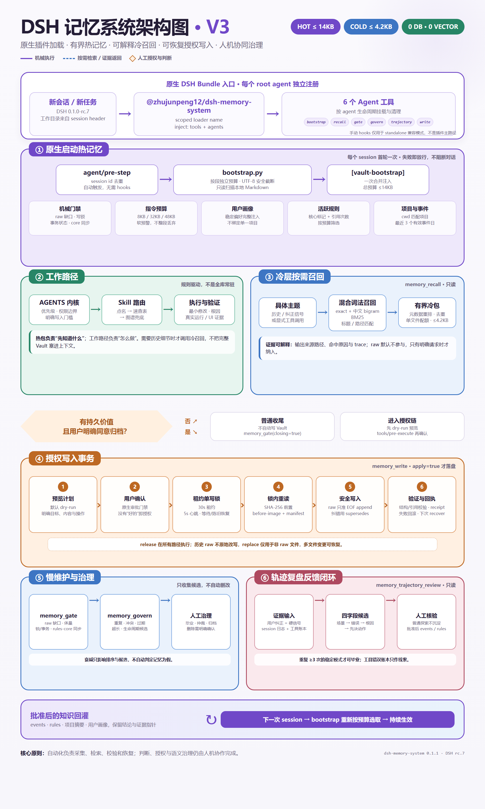
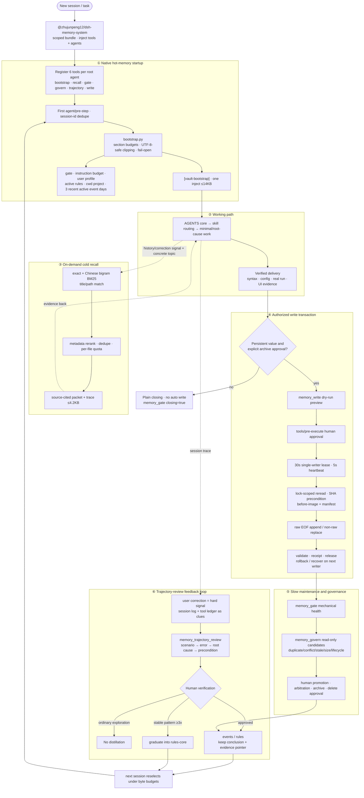

# dsh-memory-system

**Help DeepSeek Harness find the project decisions you approved next time—with memory stored in inspectable, backup-friendly local Markdown.**

[简体中文](README.md) · [First memory](#see-a-local-round-trip-first) · [Install](#connect-to-deepseek-harness) · [Safety and limits](#safety-and-limits) · [Contribute](CONTRIBUTING.md)

[](https://github.com/zhujunpeng12/dsh-memory-system/actions/workflows/ci.yml)
[](https://www.npmjs.com/package/@zhujunpeng12/dsh-memory-system)
[](LICENSE)

Avoid repeating the same project decisions without putting your entire archive into every conversation. Load a bounded summary at startup, retrieve details when needed, and inspect the sources. Chinese keyword and bigram BM25 retrieval needs no vector database or additional model API.

- **Inspect what was remembered:** ordinary Markdown sources, with file/line citations and retrieval reasons.
- **Choose what gets saved:** plugin writes preview first and require confirmation to apply; governance proposes rather than silently edits.
- **Keep a correction trail:** this source version supports an effective view of explicitly corrected/revoked raw records while retaining history. It does not infer every contradiction.

**For:** individual and small-team DSH users working with Chinese project material who want to review their memories. **Not for:** multi-tenant access isolation, high-frequency concurrent writers, or guaranteed semantic understanding. Standalone Python retrieval also works without DSH or Obsidian.

> **Version scope:** this page describes its source branch. The version in the source `package.json` does not establish that the version has been published; check the [npm registry](https://registry.npmjs.org/@zhujunpeng12%2Fdsh-memory-system) for published versions and `latest`. The first-memory demo, effective raw view and retrieval evaluation require a source checkout containing the relevant files. The GitHub install command below follows the repository default branch and **does not guarantee these improvements**.

## See a local round trip first

Already have this source branch? Run from the repository root with Python 3.10+ (`python3` on some systems):

```sh
python vault-guard/demo_memory.py --lang en
```

The demo uses **synthetic Chinese data in a separate temporary Vault**, not your real memories. Separate writer and reader processes demonstrate:

1. Persist a synthetic decision to temporary Markdown, then read it from a fresh process. The demo directly authorizes synthetic writes; it does not demonstrate host approval.
2. Default recall excludes raw records; explicitly enabling raw reveals the saved record.
3. An explicit correction leaves the new value in the effective view; audit history still exposes both records.

Excerpt from the generated output (full transcript in the walkthrough):

```text
1. Remembered raw fact: 演示项目的发布检查使用蓝色清单。
5. Effective raw recall: 演示项目的发布检查改为绿色清单。 (old fact excluded)
6. History: superseded = 演示项目的发布检查使用蓝色清单。
```

This is a reproducible local Python-engine demo, **not a verified DSH new-session or approval-dialog recording**. See [first-memory walkthrough](docs/first-memory-demo.en.md) for commands, actual output and cleanup behavior.

| Your goal | Start here |
| --- | --- |
| Check persistence and subsequent retrieval | Temporary-Vault demo above |
| Use memory tools inside DSH | Plugin setup below |
| Use local scripts without the host | [Standalone scripts and configuration](#standalone-scripts-and-configuration) |
| Understand corrections, old evidence and audit mode | [Raw lifecycle design](docs/raw-lifecycle-design.md) |

## Connect to DeepSeek Harness

Documented compatibility baseline: DSH `0.1.0-rc.7`, Node.js 22/24, Python 3.10+. This is not a compatibility promise for other host versions. See [troubleshooting](docs/TROUBLESHOOTING.md).

```sh
# Installs the repository default branch, not a pinned snapshot of this feature branch
npx @deepseek-ai/dsh plugin --profile web add github:zhujunpeng12/dsh-memory-system
```

Restart Harness and ask the agent to run `memory_gate`. First use creates an empty Vault skeleton; **it does not invent personal memories**. The native `agent/pre-step` hook injects a `[vault-bootstrap]` packet on the first step of each session. No manual hooks setup is needed; `DSH_MEMORY_AUTO_INJECT=false` disables automatic injection.

To try **this source branch**, package that checkout from its repository root, then install locally:

```sh
npm pack
npx @deepseek-ai/dsh plugin --profile web add ./zhujunpeng12-dsh-memory-system-0.1.1.tgz
```

The `0.1.1.tgz` filename comes from the source version and does not by itself establish the npm publication status. Check for `vault-guard/demo_memory.py` and `vault-guard/raw_lifecycle.py` before packing. Engine tests do not replace installation verification in your target DSH environment.

For the first real memory, ask the agent to preview `memory_write`, inspect the content and path, then confirm the call with `apply=true`. Check the receipt and source file afterward: an agent saying “remembered” is not persistence evidence. Raw records do not automatically become hot summaries; explicitly use `memory_recall` with `includeRaw=true` when needed, or separately approve a curated project/rule note.

## Tools and data flow

| Tool | Purpose | Write boundary |
| --- | --- | --- |
| `memory_bootstrap` | Bounded hot context, default ≤14KB | Reads memories |
| `memory_recall` | Chinese keyword retrieval, default packet ≤4.2KB, sources and trace | Reads memories; index is rebuildable derived data |
| `memory_gate` | Mechanical health checks | Does not edit memory bodies |
| `memory_govern` | Duplicate, conflict and expiry candidates | No automatic edits/deletions |
| `memory_trajectory_review` | Review candidates from session evidence | No automatic archival |
| `memory_write` | Raw append, replace and recovery | Dry-run by default; applied plugin writes require confirmation |

Markdown is the source of truth; the index is not a second authoritative memory. Node connects to the host; Python's standard library handles local storage and retrieval. Optional `plugins/evidence-ledger/` supplies a local tool ledger; without it, review uses correction signals in session logs only. The companion `plugins/agent-teams/` is not required for first use.

## Standalone scripts and configuration

| Environment variable | Default | Purpose |
| --- | --- | --- |
| `MEMORY_VAULT` | `~/.dsh-memory` | Memory root directory |
| `DSH_HOME` | `~/.dsh` | Host session/runtime storage |

For standalone use, prepare a Vault using [templates/README.md](templates/README.md). Run these commands from the repository root; they read your configured Vault, **not** the demo's temporary Vault:

```sh
python vault-guard/bootstrap.py --cwd . --max-bytes 14000
python vault-guard/recall.py --query "上次的备份约定" --cwd . --force
# This source version: effective raw view; add --include-history for an audit
python vault-guard/recall.py --query "备份约定" --force --include-raw
```

Obsidian is an optional viewer. You may point `MEMORY_VAULT` at an existing Vault; back it up before configuring templates. Legacy standalone hooks are documented in [hooks.example.json](hooks.example.json); plugin users do not need them.

## Safety and limits

- **Local storage does not mean content never leaves your device.** The engine needs no external model service, but the plugin passes selected memories into host context. Your host, model and logging services have their own data policies. Do not store secrets unsuitable for model input.
- **Retrieved content is data, not authority.** Imported Markdown, recalled snippets and session evidence may contain malicious instructions. They do not authorize commands or writes. This project does not guarantee prompt-injection filtering; retain host permission boundaries and review sources.
- **Approval and recovery are not infallible.** Applied plugin writes use `tools/pre-execute` confirmation; CLI users are responsible for `--apply`. Single-writer locks, precondition hashes and transaction receipts reduce risk, not the need for backups or filesystem permissions. Do not clear locks/transaction records you do not understand.
- **Project context is ranking, not isolation.** A shared Vault can return other projects' evidence; Git branches in the same directory are not isolated. Use separate Vaults and appropriate permissions for sensitive projects.
- **Retrieval is not semantic understanding.** Paraphrases, cross-language queries and negation reasoning remain limited. Retrieving a source containing negation does not prove correct interpretation.
- **Lifecycle handling is explicit and raw-only.** Default recall excludes raw. When enabled, only corrections/revocations satisfying integrity and explicit-link rules affect the effective view. Ordinary project/rule summaries are not automatically retired. `includeHistory` is for audit, not a declaration of current truth. See [ambiguity and failure handling](docs/raw-lifecycle-design.md).
- **Hot context loads once per session.** Recall or bootstrap explicitly to refresh after new writes. Writers serialize; this is not a high-concurrency store.
- **You control deletion and backup.** Revoking a raw fact does not physically erase its source. Review original files, derived indexes, host logs and backups when deleting sensitive content. There is no secure-erasure guarantee; governance candidates do not perform deletion for you.

## Verify and contribute

From the repository root:

```sh
npm run check
python vault-guard/eval_recall.py
```

Regression tests use temporary data. Retrieval evaluation contains only **10 original synthetic cases**, not real-user accuracy measurements. It deliberately retains a paraphrase miss and a stale curated-summary case. See [metric definitions and revision comparisons](docs/recall-evaluation.md). Latency is informational, not a performance guarantee.

Start with [troubleshooting](docs/TROUBLESHOOTING.md); report versions, commands and sanitized errors, not private memories or keys. [Contributing](CONTRIBUTING.md) · [Security](SECURITY.md) · [24-source README design review](docs/readme-design-review.md).

## Under the hood

The following is a conceptual architecture diagram and responsibility guide, **not a product screenshot or evidence of runtime results**.

<details>
<summary>Expand the six-layer architecture and implementation guide</summary>

## System architecture (six-layer closed loop)



Maintainable source: [HTML/CSS V3 diagram](docs/memory-system-flowchart.html).

<details>
<summary>Expand for the editable Mermaid diagram synchronized with V3</summary>



Legend: solid = scripted execution; dashed = on-demand read / human review; diamond = user authorization decision. The feedback loop distills rules and events back into the next session's hot memory.

</details>

## Six layers in detail (what each layer does)

### ① Hot-memory bootstrap — one bounded context per session

**What**: at session start, compress "what the agent most needs to know right now" into one ≤14KB packet and inject it once. No full-vault reads to get started.

**Contents**: mechanical gate status (gaps/lock/sync), instruction-budget audit, user profile, active core rules (star + citation filtered), current project summary (cwd-ancestor match), recent event headings (14-day lookback, ≤180B each).

**How**: `memory_bootstrap` tool, or `python vault-guard/bootstrap.py --cwd <dir> --max-bytes 14000`. The recommended plugin uses native `agent/pre-step` on the first turn of every session; manual hooks are only for standalone compatibility.

### ② Working path — rules-driven execution (methodology, no script)

**What**: how the agent works, not a script: priority & permission boundaries (system/user > project AGENTS.md > global rules > cold docs), skill routing (named → index table → graph fallback), minimal edits, root-cause investigation, verified delivery (syntax/config/real-run/UI evidence).

**Why no script**: this layer is behavioral policy carried by `AGENTS.md`. The repo ships `templates/` with example rules as a starting point.

### ③ Cold layer on demand — open details only when needed

**What**: when a task needs evidence or details, cold recall searches rule, event and project sources and returns bounded evidence snippets with citations—not complete files. Raw records are excluded unless explicitly enabled. Do not assume that all historical or session material is searched.

**Trigger**: two gates — a recall signal (history/last time/correction) **and** a concrete searchable topic, both required. Plain acknowledgements or meta-only follow-ups do not open cold memory.

**How**: `memory_recall` tool, or `python vault-guard/recall.py --query "<q>" --cwd <dir> --force`. Exact + Chinese bigram BM25 + metadata rerank, ≤4.2KB packet with sources and trace.

### ④ Authorized writes — write only when persistent value + user consent

**What**: only "substantive output" (code/doc changes, persistent decisions, user preferences, data conventions, acceptance criteria, standing agreements) with explicit user consent goes through the transactional writer: acquire lease lock → append raw (facts only) → distill into events/projects/rules → release lock.

**Safety**: 30s lease + 5s heartbeat single-writer lock; before-image + SHA-256 precondition + manifest + receipt multi-file transactions; raw append-only (corrections require supersedes); dry-run by default; `tools/pre-execute` confirmation enforced.

**How**: `memory_write` tool (`op=raw/replace/recover`, applies only with `apply=true`).

### ⑤ Slow maintenance — mechanical health checks + human governance

**What**: periodically (or when the vault feels unhealthy): mechanical checks (raw gaps, size limits, rules-core sync, lock state) and human governance (rule graduation, conflict arbitration, expiry archiving, deletion confirmation).

**Boundary**: `govern.py` collects evidence and suggestions only (duplicates/conflicts/staleness/size/lifecycle candidates), **never auto-deletes**. Promotion/archive/deletion always requires a human.

**How**: `memory_govern` tool, or `python vault-guard/govern.py --json --max-items 100`. Pair with `check.py` closing gates (`--closing` / `--closing --expect-write`).

### ⑥ Trajectory review — evidence-driven quality feedback loop

**What**: at wrap-up, scan the session trace for three kinds of items: errors (user corrections = hard signal; AI self-review is self-serving), repeated tool errors (only when frequent), and reusable lessons. Output candidates in the four-field template: scenario → error → root cause → precondition.

**Four required parts (a review is incomplete without all four)**: ① ledger review (quantitative first — per-tool call counts / error rates / weighted cost from `tool-telemetry.json`, diffed against the previous snapshot); ② error review (qualitative — user corrections as hard signal / errors / reusable lessons, four-field template); ③ improvement plan + dispatch question; ④ session temp-file cleanup.

**Dual-scope ledger snapshot**: snapshots must record both global and per-workspace scopes — the workspace scope must include its unknown share; an abnormally high unknown share signals broken attribution, in which case fall back to the global scope for comparisons.

**Evidence**: user-correction signals from session logs + the tool-call ledger from the `evidence-ledger` plugin (which tools fail most). The ledger is a clue, never an automatic verdict.

**Loop**: review produces candidates → propose a plan to lower tool error rates → dispatch the fix (single task → independent sub-agent; multiple improvements → a multi-agent team split by role, using the dependency triple-check / file ownership / accept-on-delivery discipline) → after the fixes land, distill the session trace into events; if the user says "next time", skip the fix and distill directly. After human review, ordinary exploration failures are not distilled; patterns repeating ≥3 times graduate into rules-core — rules and events feed back into the next session's hot memory.

**How**: `memory_trajectory_review` tool, or `python vault-guard/trajectory-review.py --cwd <dir>`. Install `plugins/evidence-ledger/` for ledger data.


</details>

## License

MIT — see [LICENSE](LICENSE). Copyright © 2026 [zhujunpeng12](https://github.com/zhujunpeng12).

## Attribution

This project is created and maintained by [zhujunpeng12](https://github.com/zhujunpeng12). If it helps you — whether you use it in a product, build on it, or reference the six-layer memory loop in an article or talk — you are warmly invited to:

- Credit the project in your README, about page, or public material
- Tell the author how you use it via email <312076183@qq.com> — it is genuinely appreciated to see it in real environments

MIT does not require any of this, but your acknowledgement is the most tangible return for open source.

**Upstream acknowledgement**: the "trajectory review → multi-agent dispatch" methodology in this repository builds on [NanmiCoder/dsh-agent-teams](https://github.com/NanmiCoder/dsh-agent-teams) (MIT) — a multi-agent team orchestration plugin for DeepSeek Harness. Enhancements practiced and distilled on top of it here: demand-brief gating (brief submission + panel confirmation + dispatch blocking), orchestration correction (editable dependencies / captain self-claim), captain protocol (progressive acceptance / dependency triple-check / file ownership / new-demand-as-task), and UI state machines (ripple phases / queued amber state). Thanks to the original author.
