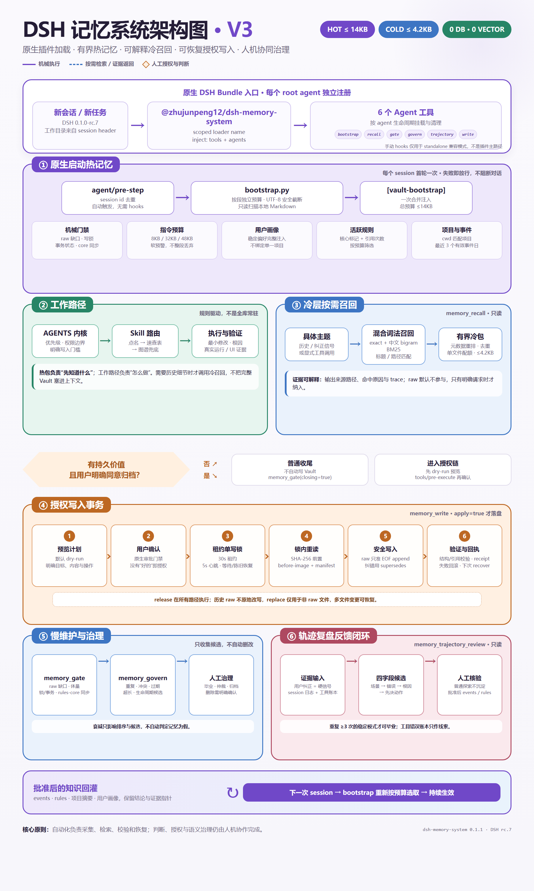
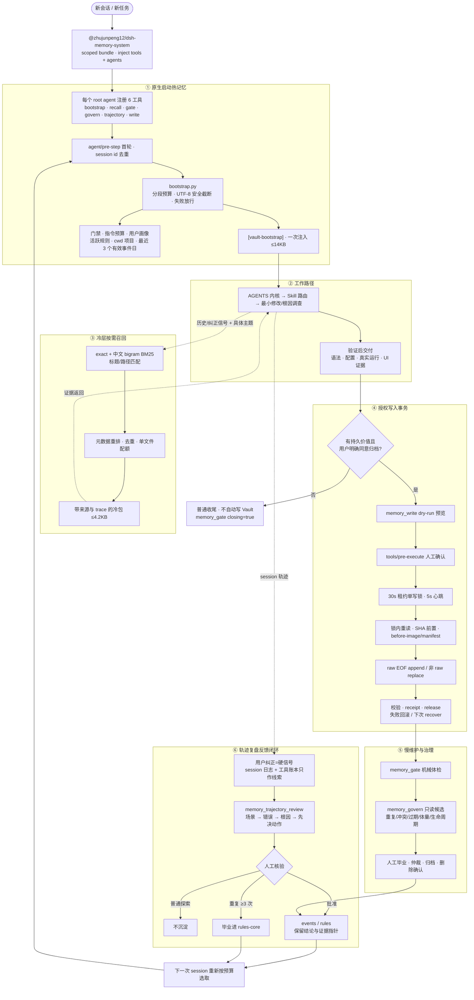

# dsh-memory-system

**让 DeepSeek Harness 下次还能找到你确认过的项目约定，记忆保存在可查看、可备份的本地 Markdown。**

[English](README.en.md) · [首次记忆演示](#先看一次真实的本地闭环) · [安装](#接入-deepseek-harness) · [安全与限制](#安全与限制) · [贡献](CONTRIBUTING.md)

[](https://github.com/zhujunpeng12/dsh-memory-system/actions/workflows/ci.yml)
[](https://www.npmjs.com/package/@zhujunpeng12/dsh-memory-system)
[](LICENSE)

不用反复解释同一个项目决定，也不用把整个记忆库塞进每次对话：启动时读取有预算的摘要，需要历史细节时再检索，并返回来源。中文检索使用关键词与 bigram BM25，不依赖向量数据库或额外模型 API。

- **你能检查它记住了什么**：源文件是普通 Markdown；召回包含文件/行号与匹配线索。
- **你决定何时保存**：插件写入默认预览，实际执行需确认；治理只给候选，不自动删改。
- **纠正有记录可追**：本源码版本支持显式 raw 纠正/撤销的有效视图，历史仍保留。不是自动理解所有冲突。

**适合**使用 DSH、主要处理中文项目资料、愿意审阅记忆的个人和小团队。**不适合**需要多租户权限隔离、高频多写者或语义理解保证的场景。独立 Python 检索也可用，不必安装 DSH 或 Obsidian。

> **版本说明**：本页描述所在源码分支。源码 `package.json` 中的版本号不代表该版本已发布，请到 [npm registry](https://registry.npmjs.org/@zhujunpeng12%2Fdsh-memory-system) 核对实际发布版本和 `latest`。首次记忆演示、raw 有效视图与检索评估需使用包含相关文件的源码检出。下面的 GitHub 安装命令跟随仓库默认分支，**不保证包含这些改进**。

## 先看一次真实的本地闭环

已有本分支源码？在仓库根目录运行，需 Python 3.10+（某些系统命令为 `python3`）：

```sh
python vault-guard/demo_memory.py
```

演示使用**合成中文资料和独立临时记忆库**，不读取你的真实 Vault；通过独立进程写入和检索，展示：

1. 将一条合成约定实际写入临时 Markdown，再由新进程读取。演示直接授权合成数据写入，不展示宿主审批。
2. 默认召回不含 raw；显式开启 raw 后才能找到这条原始记录。
3. 写入明确的纠正后，有效视图保留新值；审计历史仍能看到新旧记录。

实际输出节选（完整记录见演示指南）：

```text
1. 记下原始事实：演示项目的发布检查使用蓝色清单。
5. 当前有效记忆：演示项目的发布检查改为绿色清单。（旧说法已排除）
6. 历史记录：已替代 = 演示项目的发布检查使用蓝色清单。
```

这是本地 Python 引擎的可复现演示，**不是已验证的 DSH 新会话或宿主确认弹窗录像**。完整命令、实际输出与清理说明见[首次记忆演示](docs/first-memory-demo.zh-CN.md)。

| 你想做什么 | 入口 |
| --- | --- |
| 先确认保存和再读取是否工作 | 上面的临时库演示 |
| 在 DSH 中使用记忆工具 | 下方插件安装与验证 |
| 不装宿主，只用本地脚本 | [独立脚本与配置](#独立脚本与配置) |
| 了解纠正、旧记录与审计的边界 | [raw 生命周期](docs/raw-lifecycle-design.md) |

## 接入 DeepSeek Harness

文档兼容基线：DSH `0.1.0-rc.7`、Node.js 22/24、Python 3.10+。这不是对其他宿主版本的兼容承诺；安装问题见[排障](docs/TROUBLESHOOTING.md)。

```sh
# 安装仓库默认分支；并非本功能分支的固定快照
npx @deepseek-ai/dsh plugin --profile web add github:zhujunpeng12/dsh-memory-system
```

重启 Harness，让 Agent 执行 `memory_gate`。首次使用会创建空的记忆库骨架，**不会凭空生成个人记忆**。插件通过原生 `agent/pre-step` 在每个会话首轮注入 `[vault-bootstrap]` 热包；无需手动配置 hooks。可用 `DSH_MEMORY_AUTO_INJECT=false` 关闭自动注入。

要试用**本源码分支**，在该检出的仓库根目录打包，再本地安装：

```sh
npm pack
npx @deepseek-ai/dsh plugin --profile web add ./zhujunpeng12-dsh-memory-system-0.1.1.tgz
```

此处 `0.1.1.tgz` 是由源码版本号生成的本地包，其文件名本身不能证明 npm 发布状态；确认打包前存在 `vault-guard/demo_memory.py` 和 `vault-guard/raw_lifecycle.py`。本地引擎测试不能代替目标 DSH 环境的安装验证。

首次真正保存时，让 Agent 先用 `memory_write` 生成预览，检查内容与路径，再确认 `apply=true` 的调用。保存后检查写入回执和来源文件；“已经记住”这句回复不是落盘证据。raw 原始记录不会自动变成热包摘要，必要时显式调用 `memory_recall` 的 `includeRaw=true`，或经确认另行整理为项目/规则笔记。

## 工具与数据流

| 工具 | 用途 | 写入边界 |
| --- | --- | --- |
| `memory_bootstrap` | 有预算的热包，默认 ≤14KB | 读取记忆 |
| `memory_recall` | 中文关键词检索，默认冷包 ≤4.2KB，带来源与 trace | 读取记忆；索引是可重建的派生数据 |
| `memory_gate` | 机械健康检查 | 不修改记忆正文 |
| `memory_govern` | 重复、冲突、过期等治理候选 | 不自动删改 |
| `memory_trajectory_review` | 从会话证据中提取复盘候选 | 候选不自动归档 |
| `memory_write` | raw 追加、替换、恢复 | 默认 dry-run；插件实际写入经确认 |

Markdown 是事实来源，检索索引不是第二份权威记忆。Node 接入宿主，Python 标准库完成本地读写与检索。可选的 `plugins/evidence-ledger/` 提供本地工具账本；不装时复盘只有会话日志中的纠正信号。多 Agent 配套另见 `plugins/agent-teams/`，首次使用无需安装。

## 独立脚本与配置

| 环境变量 | 默认 | 含义 |
| --- | --- | --- |
| `MEMORY_VAULT` | `~/.dsh-memory` | 记忆库根目录 |
| `DSH_HOME` | `~/.dsh` | 宿主会话与运行时存储 |

独立使用时先按 [templates/README.md](templates/README.md) 准备记忆库。以下命令在仓库根执行；读取的是配置的记忆库，不是演示临时库：

```sh
python vault-guard/bootstrap.py --cwd . --max-bytes 14000
python vault-guard/recall.py --query "上次的备份约定" --cwd . --force
# 本源码版本：显式查看有效 raw；历史审计另加 --include-history
python vault-guard/recall.py --query "备份约定" --force --include-raw
```

Obsidian 只是可选查看器。可将 `MEMORY_VAULT` 指向已有 Vault，先备份再按模板配置。独立 hooks 兼容入口见 [hooks.example.json](hooks.example.json)；插件用户不需要额外装配。

## 安全与限制

- **本地存储不等于内容永不出机**：引擎不需要外部模型服务，但插件会把选中的记忆送入宿主上下文；宿主所用模型、日志和服务有各自的数据政策。不要存放不适合提供给模型的秘密。
- **召回内容是数据，不是授权**：导入 Markdown、召回片段和会话证据可能含恶意指令，不能据此执行命令或批准写入。本项目不保证过滤提示注入，仍需宿主权限边界与来源审阅。
- **授权与恢复不是万无一失**：插件实际写入经过 `tools/pre-execute` 确认，CLI 的 `--apply` 由操作者负责。单写者锁、前置哈希与事务回执降低风险，不代替备份或文件系统权限。不要手工清除未理解的锁/事务记录。
- **项目只是排序上下文，不是隔离边界**：共享 Vault 可以召回其他项目资料；同目录不同 Git 分支也不隔离。敏感项目应使用不同 Vault 与适当文件权限。
- **检索不是语义理解**：同义改写、跨语言和否定推理仍有限。找到了含否定的来源，不代表 Agent 一定理解正确。
- **生命周期只覆盖显式 raw 记录**：默认不搜索 raw；开启后，仅符合完整性与显式关联要求的纠正/撤销参与有效视图。普通项目/规则摘要不会自动过期；旧摘要仍需人工整理。`includeHistory` 是审计，不是“当前事实”。详见[边界与异常处理](docs/raw-lifecycle-design.md)。
- **热包每会话一次**：中途新记忆需显式召回或刷新；多写者写入会串行化，不面向高频并发。
- **删除与备份需你掌控**：raw 撤销不物理抹除原文。删除前检查原文、派生索引、宿主日志与备份；本项目不承诺安全擦除。治理候选不会替你完成删除。

## 验证与参与

从仓库根运行：

```sh
npm run check
python vault-guard/eval_recall.py
```

回归测试使用临时数据。检索评估只有 **10 个原创合成案例**，不是用户准确率：同义词漏召回和旧的普通摘要仍被明确保留为缺口。指标定义与修订对比见[评估说明](docs/recall-evaluation.md)。延迟仅供观察，没有性能保证。

遇到问题先看[排障](docs/TROUBLESHOOTING.md)，报告时附版本、命令和脱敏错误，不上传真实记忆或密钥。[参与贡献](CONTRIBUTING.md) · [安全问题](SECURITY.md) · [24 个公开 README 的结构研究与本次取舍](docs/readme-design-review.md)。

## 深入了解

下面是概念架构图与职责说明，**不是产品运行截图或效果证明**。

<details>
<summary>展开六层架构与实现入口</summary>

## 系统架构（六层闭环）



可维护图源：[HTML/CSS V3 源图](docs/memory-system-flowchart.html)。

<details>
<summary>展开查看可编辑的 Mermaid 源码图（与 V3 PNG 同步）</summary>



图例:实线 = 脚本机械执行;虚线 = 按需读取 / 人工核验;菱形 = 用户授权判断。反馈闭环:轨迹复盘产出的规则与事件,回灌到下一次会话的热记忆。

</details>

## 六层职责详解（每一层做什么）

### ① 启动热记忆 — 每个会话一次的有界上下文

**做什么**：新会话开始时，把「此刻最该知道的记忆」压缩成一个 ≤14KB 热包一次注入，让 Agent 不读全库也能带着上下文开工。

**包含**：机械门禁状态（缺口/锁/同步）、指令预算审计、用户画像、活跃核心规则（按 ⭐ 与引用计数筛选）、当前项目摘要（按 cwd 祖先匹配）、最近事件主标题（14 天回溯、单条 ≤180B）。

**怎么用**：`memory_bootstrap` 工具，或 `python vault-guard/bootstrap.py --cwd <项目目录> --max-bytes 14000`。推荐插件形态通过原生 `agent/pre-step` 在每个 session 首轮自动执行；手动 hooks 仅用于 standalone 兼容模式。

### ② 工作路径 — 按规则执行任务（方法论层，无脚本）

**做什么**：这是「Agent 怎么干活」的约定，不是脚本——热包注入后，Agent 按优先级与权限边界执行：系统/用户指令 > 项目 AGENTS.md > 全局规则 > 冷文档；技能路由（点名 → 速查表 → 图谱兜底）；最小修改、根因调查；交付前验证（语法/配置/真实运行/界面证据）。

**为什么没有脚本**：这一层是行为规范，由 `AGENTS.md` 承载。开源版提供 `templates/` 里的示例规则作为起点，使用者按自己的团队文化改写。

### ③ 冷层按需读取 — 需要细节才打开

**做什么**：热包只有摘要，需要细节时再检索规则、事件与项目等来源；返回有预算的证据片段。raw 默认不包含，须显式开启；不要将片段当作完整文件。

**触发**：双门槛——同时满足「历史/上次/纠正等召回信号」+「可检索的具体主题」才触发；纯确认语、复测元指令不打开。

**怎么用**：`memory_recall` 工具，或 `python vault-guard/recall.py --query "<问题>" --cwd <目录> --force`。exact + 中文 bigram BM25 + 元数据重排，输出 ≤4.2KB 冷包并附来源与 trace。

### ④ 授权写入 — 有持久价值且用户同意才写

**做什么**：只有「实质产出」（代码/文档变更、持久决策、用户偏好、数据口径、验收标准、下次仍需遵守的约定）且用户同意归档时，才走事务写入：拿租约锁 → 写 raw（只记事实不评价）→ 提炼归位（events/项目/rules/toolmap）→ 释放锁。

**安全机制**：30s 租约 + 5s 心跳单写者锁、before-image + SHA-256 前置 + manifest + receipt 多文件事务、raw 机械只追加（纠错必须 supersedes）、默认 dry-run、`tools/pre-execute` 强制确认。

**怎么用**：`memory_write` 工具（`op=raw/replace/recover`，`apply=true` 才落盘）。

### ⑤ 慢维护 — 机械体检 + 人工治理

**做什么**：定期（或怀疑记忆库不健康时）做两件事——机械体检：raw 缺口、体量超线、rules-core 同步、写锁状态；人工治理：规则毕业、冲突仲裁、过期归位、删除确认。

**边界**：`govern.py` 只收集证据与建议（重复/冲突/过期/体量/生命周期候选），**永不自动删改**；晋升/归档/删除永远需要人确认。

**怎么用**：`memory_govern` 工具，或 `python vault-guard/govern.py --json --max-items 100`。配合 `check.py` 的收尾门禁（`--closing` / `--closing --expect-write`）使用。

### ⑥ 轨迹复盘 — 证据驱动的质量反馈闭环

**做什么**：收尾时回溯会话轨迹，找三类点：错误（用户纠正 = 硬信号；AI 自评有自我辩护倾向）、error（仅频繁时写）、可借鉴。产出按「场景 → 错误 → 根因 → 先决动作」四字段模板的复盘候选。

**复盘四要素（缺一不算做完）**：①工具账本复盘（定量先行——`tool-telemetry.json` 各工具调用次数/错误次数/错误率/加权成本，与上轮快照做差值）；②错误复盘（定性——用户纠正硬信号/error/可借鉴，四字段模板）；③优化方案 + 派发询问；④会话临时文件清理。

**账本双口径**：快照必须记全局 + 工作区双口径——工作区口径须含 unknown 占比，unknown 异常高 = 归属失效信号，差值不可比时改全局口径。

**证据来源**：session 日志中的用户纠正信号 + `evidence-ledger` 插件的工具调用账本（谁的工具最常出错）。账本只作线索，不自动判错。

**闭环**：复盘出候选 → 给出降低工具错误率的方案 → 派发解决（单一任务 → 独立子 agent；优化点多 → 多 agent 团队按角色分工，依赖三问/文件所有权/交付即验收）→ 解决完成后解析会话轨迹写入 events；用户说「下次再处理」→ 跳过解决、直接写入 events。人工核验后，普通探索失败不沉淀；重复 ≥3 次的模式毕业进 rules-core——规则与事件回灌到下一次会话的热记忆，形成进化闭环。

**怎么用**：`memory_trajectory_review` 工具，或 `python vault-guard/trajectory-review.py --cwd <目录>`。配套安装 `plugins/evidence-ledger/` 才有工具账本数据；多 agent 派发执行件见 `plugins/agent-teams/`（基于 [NanmiCoder/dsh-agent-teams](https://github.com/NanmiCoder/dsh-agent-teams) 的增强 fork）。


</details>

## 许可证

MIT — 详见 [LICENSE](LICENSE)。版权所有 © 2026 [zhujunpeng12](https://github.com/zhujunpeng12)。

## 引用与致谢

本项目由 [zhujunpeng12](https://github.com/zhujunpeng12) 创建并维护。如果它帮助到了你——在你的产品里使用了它、基于它做了二次开发、或在文章 / 分享中引用了这套「六层记忆闭环」的理念——欢迎：

- 在你项目的 README、关于页或公开材料中署名致谢
- 通过邮件 <312076183@qq.com> 告知作者你的使用场景，作者很乐意看到它被用在真实环境里

MIT 许可不强制这些，但你的致谢是对开源最实在的回馈。

**上游致谢**：本仓库「轨迹复盘 → 多 agent 派发解决」的方法论受益于 [NanmiCoder/dsh-agent-teams](https://github.com/NanmiCoder/dsh-agent-teams)（MIT 许可）——一个为 DeepSeek Harness 提供多 agent 团队编排的插件。本仓库在其基础上实践并沉淀的增强方向：需求确认单门禁（brief 提交 + 面板确认 + 派活拦截）、编排纠错（依赖可改 / 队长可认领）、队长协议（渐进式验收 / 依赖三问 / 文件所有权 / 追加需求建任务）、UI 状态机（波纹相位 / 待命橙色态）等，供同样做多 agent 编排的同仁参考。感谢原作者的贡献。
